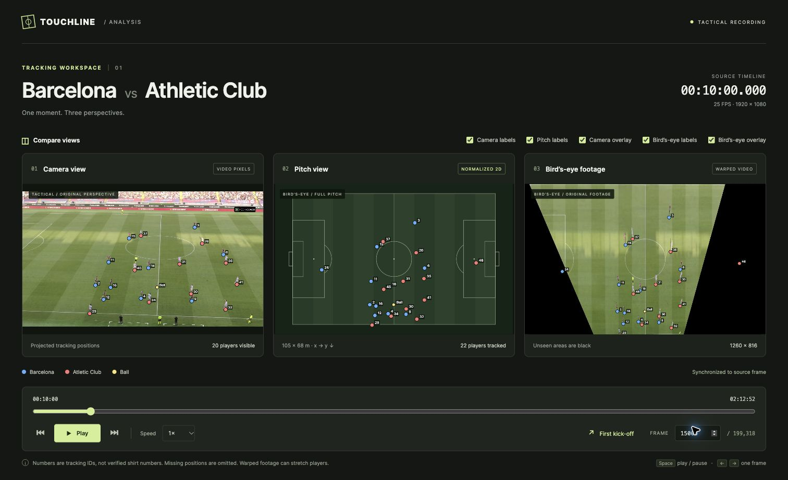
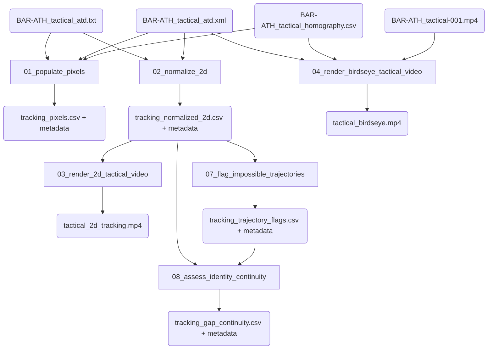
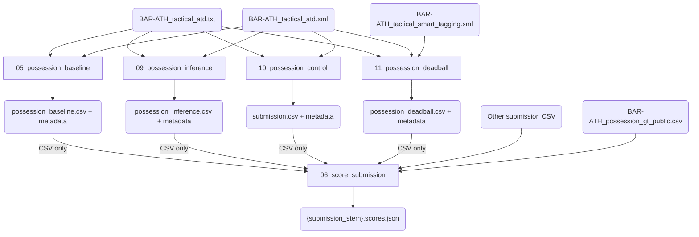

# Barcelona Go Go

Our entry for **More Than a Hack 2027, Phase 1**: label every frame of the
Barcelona vs Athletic Club tactical video as `H` (Barcelona has the ball), `A`
(Athletic has the ball) or `D` (ball dead). Submissions are ranked by `spellF1`
on the private full-match ground truth, with `macroF1` as the tie-break. The
organisers' published floor is spellF1 0.2433. Challenge rules, data terms and
the public 5-minute ground truth live in the
[organisers' repository](https://github.com/metrica-sports/more-than-a-hack-2027).

The repository has two parts:

- **Numbered pipelines** that turn the supplied tracking data into exports,
  videos and possession submissions, score those submissions, and assess
  tracking quality.
- **A local viewer** that plays the camera footage, a top-down pitch map and a
  bird's-eye warp of the footage side by side on one timeline.



## Setup

Requirements:

- Python 3.12 or newer and `uv`.
- FFmpeg with the `libx264` encoder, for pipelines 03 and 04 only.
- A browser supporting `requestVideoFrameCallback`, such as a current Chrome.
- Node.js, only for the browser-module tests.

From the repository root:

```bash
uv sync --group dev --extra test
source .venv/bin/activate
```

Get the match assets from the organisers and place them under `data/`:

```text
data/tactical/
├── BAR-ATH_tactical-001.mp4
├── BAR-ATH_tactical_atd.txt
├── BAR-ATH_tactical_atd.xml
└── BAR-ATH_tactical_homography.csv
```

Match assets and generated outputs are excluded from Git. Tactical and broadcast
recordings have separate timelines; never mix their frame numbers.

Pre-generated exports and videos are in this
[Google Drive folder](https://drive.google.com/drive/folders/1BuxSs5RT_My3yr1fbt8TtAzbFK5tiay5).
Place them under `output/` to reuse them; filenames are listed in the pipeline
READMEs.

## Pipelines

Run each step on its own with `python -m src.pipelines.<step>`. Steps never call
each other; shared code lives in `src/utilities/`. Every CLI has `--help`, logs
to stderr and prints its output paths to stdout. Existing outputs are never
overwritten, so use a fresh `--output-dir` for a rerun.

See the [pipeline index](src/pipelines/README.md) for links to each step’s
README, including commands, schemas, parameters and interpretation.

Use the [experiment registry](experiments/README.md) to record existing possession
submissions, provenance and official scores in Git, then generate a shared
comparison report without rerunning pipelines.

### Pipeline dependencies

Arrows show files consumed or produced; run each pipeline separately. The two
diagrams share the same tactical ATD and XML inputs under `data/tactical/`.
Generated files go under `output/` by default (or the chosen `--output-dir`).
Rounded boxes are files; rectangular boxes are pipelines.

**Tracking exports, videos and quality reports.** Each tracking CSV box includes
its matching `.metadata.json` sidecar; downstream steps consume both files.



Step 02 reads the raw ATD independently of step 01. Step 04 also reads original
assets directly. Step 08 needs both step 02's export and step 07's reports.

**Possession inference and scoring.** Steps 05, 09, 10 and 11 each write a
submission CSV and a matching `.metadata.json` sidecar. Step 11 also reads the
Smart Tagging XML. Step 06 consumes only the chosen submission CSV and the
ground-truth CSV; score each submission in a separate run.
The public ground truth is supplied separately by the organisers.



Steps 05, 09, 10 and 11 do not depend on the tracking exports or quality reports.

## Viewer

Generate the required exports with [step 01](src/pipelines/01_populate_pixels/README.md)
and [step 02](src/pipelines/02_normalize_2d/README.md), then start the local viewer:

```bash
python -m frontend
```

Open [http://127.0.0.1:8765](http://127.0.0.1:8765). See the
[frontend guide](frontend/README.md) for optional videos and quality reports,
custom paths, ports and playback controls.

Use the **Experiments** tab to compare recorded possession-inference runs directly
from the Git experiment registry, inspect provenance, and explore cross-pipeline
scores and fragmentation with optional evaluation-scope filtering. See the [dashboard guide](frontend/README.md#experiment-comparison).

## Data conventions

- `frame` is the zero-based source-video frame.
- `entity_id` is a tracking slot, not a shirt number or a player identity.
  `entity_type` separates players from the ball.
- Pixel positions use the original image's coordinates. Normalized pitch
  positions are fractions, with x increasing rightward and y downward.
- Missing observations stay blank in CSVs and are omitted from the views.
  Finite off-pitch positions are kept, not clamped.
- `speed_raw` is the supplied speed channel, unconverted.
- Homography reprojection error describes calibration quality, not confidence
  in a single player's position.

## Repository structure

```text
src/
├── pipelines/       # Numbered command-line pipeline packages
└── utilities/       # Shared readers, scoring, encoding, timing, logging, exports
frontend/
├── server/          # Local HTTP server and indexed CSV access
└── web/             # Browser playback, rendering, and controls
eda/                 # Exploration notebooks
tests/               # Pipeline, utility, and frontend checks
data/                # Local recording assets (ignored)
output/              # Generated exports, videos, and indexes (ignored)
```

## Development checks

Black is the Python formatter: `python -m black <paths>` to format and
`python -m black --check <paths>` to check.

```bash
python -m pytest tests/src/pipelines \
  tests/src/utilities/test_pipeline_exports.py \
  tests/src/utilities/test_pipeline_logging.py \
  tests/frontend -q

node --test tests/frontend/web/*.test.mjs
```

Some legacy tests import removed exploratory modules, so a bare `python -m pytest`
fails to collect; the commands above cover the current code. Video tests need
FFmpeg, and HTTP tests need permission to bind local ports.

The **Data & Diagnostics** tab adds public-window player–ball geometry, Smart Tagging
evidence and searchable failure intervals with jumps into the existing viewer.
Generate its report offline; see the [diagnostics guide](src/diagnostics/README.md)
and [dashboard interpretation](frontend/README.md#data--diagnostics).
