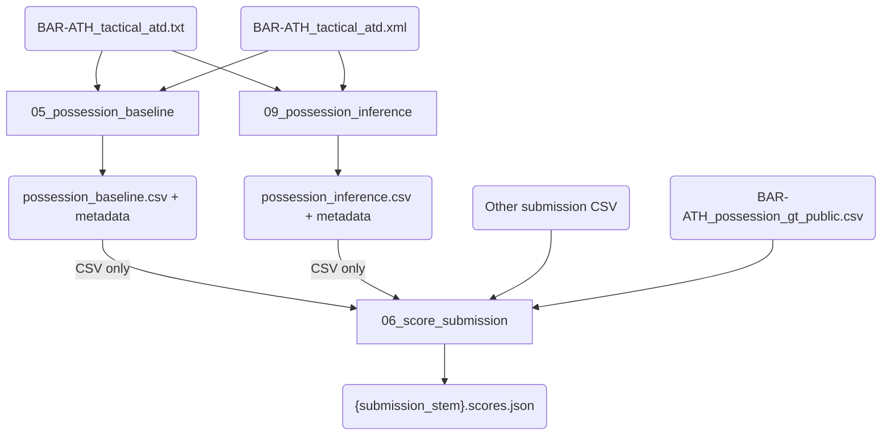

# Barcelona Go Go

Our entry for **More Than a Hack 2027, Phase 1**: label every frame of the
Barcelona vs Athletic Club tactical video as `H` (Barcelona has the ball), `A`
(Athletic has the ball) or `D` (ball dead). Submissions are ranked by `spellF1`
on the private full-match ground truth, with `macroF1` as the tie-break. The
organisers' published floor is spellF1 0.2433. Challenge rules, data terms and
the public 5-minute ground truth live in the
[organisers' repository](https://github.com/metrica-sports/more-than-a-hack-2027).

The repository has two parts:

- **Numbered pipelines** that turn the supplied tracking data into exports,
  videos and possession submissions, score those submissions, and assess
  tracking quality.
- **A local viewer** that plays the camera footage, a top-down pitch map and a
  bird's-eye warp of the footage side by side on one timeline.


## Setup

Requirements:

- Python 3.12 or newer and `uv`.
- FFmpeg with the `libx264` encoder, for pipelines 03 and 04 only.
- A browser supporting `requestVideoFrameCallback`, such as a current Chrome.
- Node.js, only for the browser-module tests.

From the repository root:

```bash
uv sync --group dev --extra test
source .venv/bin/activate
```

Get the match assets from the organisers and place them under `data/`:

```text
data/tactical/
├── BAR-ATH_tactical-002.mp4
├── BAR-ATH_tactical_atd.txt
├── BAR-ATH_tactical_atd.xml
└── BAR-ATH_tactical_homography.csv
```

Match assets and generated outputs are excluded from Git. Tactical and broadcast
recordings have separate timelines; never mix their frame numbers.

## Pipelines

Run each step on its own with `python -m src.pipelines.<step>`. Steps never call
each other; shared code lives in `src/utilities/`. Every CLI has `--help`, logs
to stderr and prints its output paths to stdout. Existing outputs are never
overwritten, so use a fresh `--output-dir` for a rerun.

| Step | Input | Output |
| --- | --- | --- |
| `01_populate_pixels` | ATD text, XML, homography CSV | `tracking_pixels.csv` and metadata JSON |
| `02_normalize_2d` | ATD text and XML | `tracking_normalized_2d.csv` and metadata JSON |
| `03_render_2d_tactical_video` | Step 02 CSV and metadata JSON | `tactical_2d_tracking.mp4`, an animated pitch map |
| `04_render_birdseye_tactical_video` | Original video, homography CSV, XML | `tactical_birdseye.mp4`, warped footage |
| `05_possession_baseline` | ATD text and XML | `possession_baseline.csv` submission and metadata JSON |
| `06_score_submission` | Any submission CSV and a ground-truth CSV | `<submission>.scores.json` with the official metrics |
| `07_flag_impossible_trajectories` | Normalized CSV and its metadata JSON | `tracking_trajectory_flags.csv` and metadata JSON |
| `08_assess_identity_continuity` | Normalized CSV, metadata, and step 07 reports | `tracking_gap_continuity.csv` and metadata JSON |
| `09_possession_inference` | Tactical ATD and XML | Experimental submission CSV and execution metadata JSON |

The [pipeline guide](src/pipelines/README.md) has the full arguments, CSV
schema, coordinate conventions and Python APIs.

### Pipeline dependencies

Arrows show files consumed or produced; run each pipeline separately. The two
diagrams share the same tactical ATD and XML inputs under `data/tactical/`.
Generated files go under `output/` by default (or the chosen `--output-dir`).
Rounded boxes are files; rectangular boxes are pipelines.

**Tracking exports, videos and quality reports.** Each tracking CSV box includes
its matching `.metadata.json` sidecar; downstream steps consume both files.


Step 02 reads the raw ATD independently of step 01. Step 04 also reads original
assets directly. Step 08 needs both step 02's export and step 07's reports.

**Possession inference and scoring.** Steps 05 and 09 each write a submission CSV
and a matching `.metadata.json` sidecar. Step 06 consumes only the chosen
submission CSV and the ground-truth CSV; score each submission in a separate run.
The public ground truth is supplied separately by the organisers.



Steps 05 and 09 do not depend on the tracking exports or quality reports.

### Make and score a submission

Step 05 writes the organisers' reference baseline: each frame goes to the team
of the tracked player nearest the ball, `D` where the ball is missing, then a
centred majority vote over ±`--window` frames (default 50). Step 06 checks any
`frame,label` file against the competition format and scores it with
`src/utilities/possession_metrics.py`, an unchanged copy of the official scorer.

```bash
python -m src.pipelines.05_possession_baseline \
  --tracking data/tactical/BAR-ATH_tactical_atd.txt \
  --metadata data/tactical/BAR-ATH_tactical_atd.xml \
  --output-dir output

python -m src.pipelines.06_score_submission \
  --submission output/possession_baseline.csv \
  --ground-truth path/to/BAR-ATH_possession_gt_public.csv \
  --output-dir output
```

The ground truth is `evaluation/gt/BAR-ATH_possession_gt_public.csv` in the
organisers' repository. It covers 5 minutes and only 17 possessions: use it to
check a pipeline, not to tune one. Distances use the metadata's 105 × 68 m
pitch, not the organisers' measured 105.3 × 68 m, so a few frames differ from
their `baseline_smooth50.csv`; the public-window scores are the same.

### Tracking quality and gaps

Step 07 flags suspicious player speed and acceleration, and suspicious ball
speed. Step 08 assesses gaps within each tracking slot using endpoint motion and
step 07's flags. Run these after step 02:

```bash
python -m src.pipelines.07_flag_impossible_trajectories \
  --tracking output/tracking_normalized_2d.csv \
  --metadata output/tracking_normalized_2d.metadata.json \
  --output-dir output

python -m src.pipelines.08_assess_identity_continuity \
  --tracking output/tracking_normalized_2d.csv \
  --metadata output/tracking_normalized_2d.metadata.json \
  --flags output/tracking_trajectory_flags.csv \
  --flags-metadata output/tracking_trajectory_flags.metadata.json \
  --output-dir output
```

These steps write separate diagnostic reports; they preserve positions, nulls
and entity IDs. A `plausible` gap means its motion is consistent with continuity,
not that a player's identity is verified. Longer gaps remain uncertain by default
(maximum two seconds), and no positions are filled. See the
[quality pipeline details](src/pipelines/README.md#flag-suspicious-trajectories)
for thresholds, report columns and interpretation.

Restart the frontend after generating the reports to load them into its tracking
quality panel. Default report paths are detected independently; use
`--trajectory-flags` and `--gap-continuity` for custom locations. See the
[frontend review controls](frontend/README.md#review-tracking-quality).

### Prepare the viewer

The viewer needs the pixel and normalized exports. The bird's-eye footage is
optional:

```bash
python -m src.pipelines.01_populate_pixels \
  --tracking data/tactical/BAR-ATH_tactical_atd.txt \
  --metadata data/tactical/BAR-ATH_tactical_atd.xml \
  --homography data/tactical/BAR-ATH_tactical_homography.csv \
  --output-dir output

python -m src.pipelines.02_normalize_2d \
  --tracking data/tactical/BAR-ATH_tactical_atd.txt \
  --metadata data/tactical/BAR-ATH_tactical_atd.xml \
  --output-dir output

python -m src.pipelines.04_render_birdseye_tactical_video \
  --video data/tactical/BAR-ATH_tactical-002.mp4 \
  --homography data/tactical/BAR-ATH_tactical_homography.csv \
  --metadata data/tactical/BAR-ATH_tactical_atd.xml \
  --output-dir output
```

Each full tactical CSV is several hundred megabytes. The bird's-eye video uses
12 pixels per metre (1260 × 816 for a 105 × 68 m pitch); areas outside the
camera image and frames without valid calibration are black. Renders start
at source time zero by default. The warp assumes a flat pitch, so bodies and
airborne objects can appear stretched; the rendered video has no audio.

Pre-generated exports and videos are in this
[Google Drive folder](https://drive.google.com/drive/folders/1BuxSs5RT_My3yr1fbt8TtAzbFK5tiay5).
Place them under `output/` with the filenames above to skip these steps.

## Viewer

```bash
python -m frontend --port 8766
```

Open [http://127.0.0.1:8766](http://127.0.0.1:8766); without `--port` the
default is 8765. The server binds only to the local machine. The first launch
indexes the CSVs under `output/frontend/`, and later launches reuse the index.
The viewer loads `output/tactical_birdseye.mp4` when present; the camera and
pitch views work without it.

Controls cover play and pause, speed, seeking, frame-number entry, single-frame
steps (arrow keys), a jump to the first kickoff, and separate label and overlay
toggles for each view. The [frontend guide](frontend/README.md) covers custom
paths and trimmed bird's-eye clips. The kickoff shortcut is approximately
frame 11186 (447.44 seconds). Stop the server with `Ctrl+C`.

When step 07/08 reports are available, the tracking-quality panel lets you
filter by entity or gap status, navigate motion episodes and gap boundaries,
and highlight the selected entity across the views.

## Data conventions

- `frame` is the zero-based source-video frame.
- `entity_id` is a tracking slot, not a shirt number or a player identity.
  `entity_type` separates players from the ball.
- Pixel positions use the original image's coordinates. Normalized pitch
  positions are fractions, with x increasing rightward and y downward.
- Missing observations stay blank in CSVs and are omitted from the views.
  Finite off-pitch positions are kept, not clamped.
- `speed_raw` is the supplied speed channel, unconverted.
- Homography reprojection error describes calibration quality, not confidence
  in a single player's position.

## Repository structure

```text
src/
├── pipelines/       # Numbered command-line pipeline packages
└── utilities/       # Shared readers, scoring, encoding, timing, logging, exports
frontend/
├── server/          # Local HTTP server and indexed CSV access
└── web/             # Browser playback, rendering, and controls
eda/                 # Exploration notebooks
tests/               # Pipeline, utility, and frontend checks
data/                # Local recording assets (ignored)
output/              # Generated exports, videos, and indexes (ignored)
```

## Development checks

Black is the Python formatter: `python -m black <paths>` to format and
`python -m black --check <paths>` to check.

```bash
python -m pytest tests/src/pipelines \
  tests/src/utilities/test_pipeline_exports.py \
  tests/src/utilities/test_pipeline_logging.py \
  tests/frontend -q

node --test tests/frontend/web/*.test.mjs
```

Some legacy tests import removed exploratory modules, so a bare `python -m pytest`
fails to collect; the commands above cover the current code. Video tests need
FFmpeg, and HTTP tests need permission to bind local ports.

### Experimental possession foundation

Pipeline 09 adds `nearest-continuity`: nearest-player team evidence with bounded
same-team missing-evidence gaps (default 25 frames). It preserves observed team
changes, resets at halftime, and writes all 199,319 tactical frames. Unknown
evidence and frames outside gameplay are X; no D inference is implemented.
It is not a validated improvement over Pipeline 05.

```bash
python -m src.pipelines.09_possession_inference \
  --tracking data/tactical/BAR-ATH_tactical_atd.txt \
  --metadata data/tactical/BAR-ATH_tactical_atd.xml \
  --strategy nearest-continuity --max-gap-frames 25 \
  --output-dir output/possession-09
```

See the [Pipeline 09 contract and reproduction commands](src/pipelines/README.md#experimental-possession-inference)
for outputs, validation, public scoring and limitations. Use a fresh output
directory for each run and do not tune against the public ground truth.
